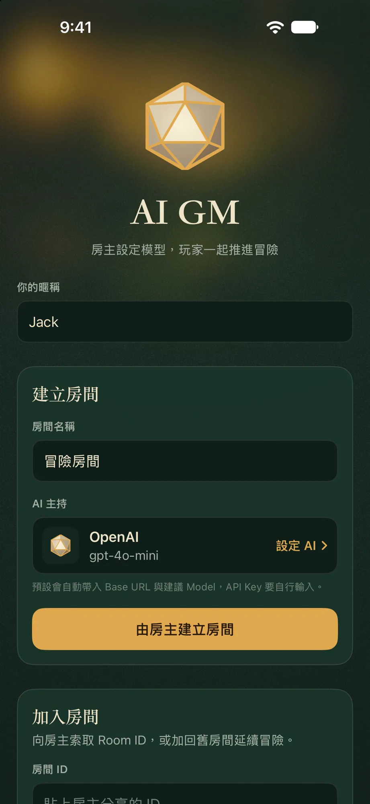
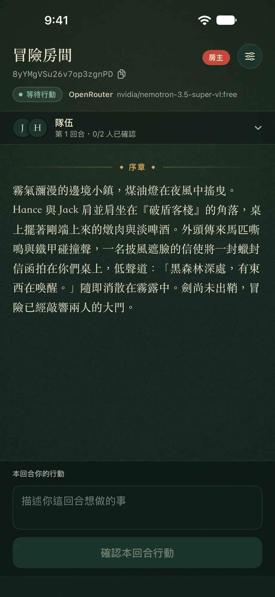
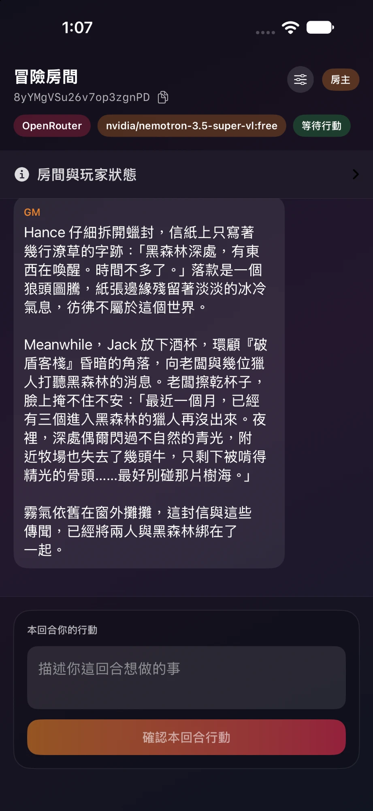
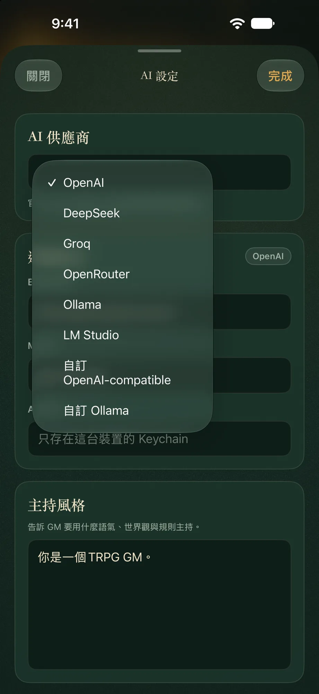
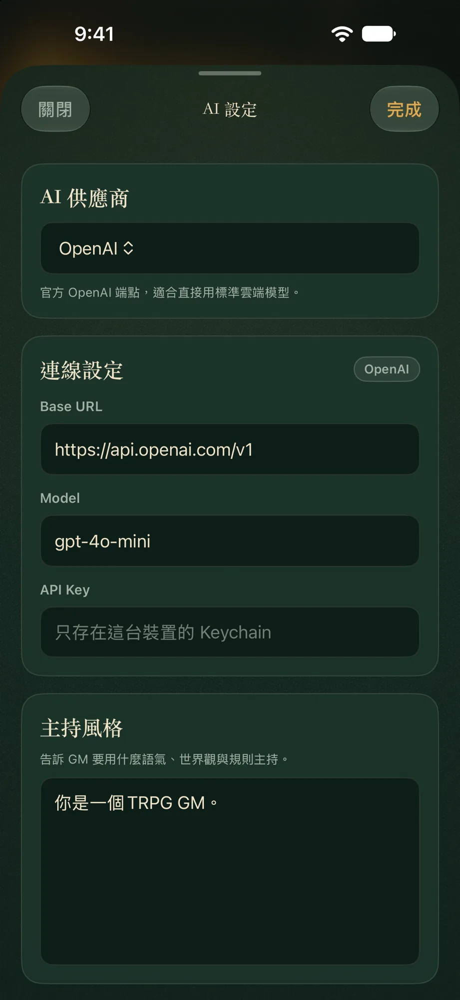
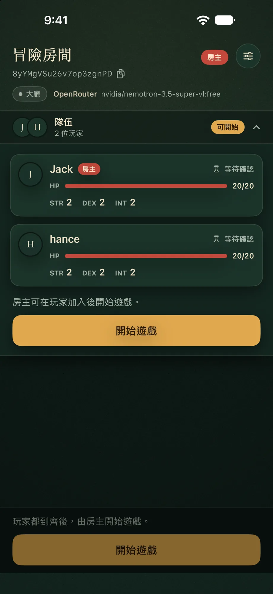
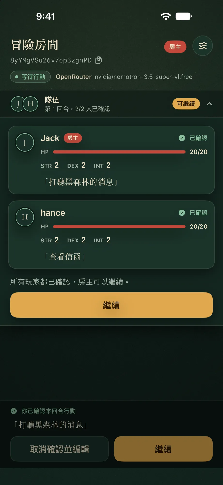

<div align="center">

# 🎲 AI GM

**讓 AI 擔任 TRPG 遊戲主持人，多名玩家即時連線、一起推進冒險的 iOS App**


&nbsp;&nbsp;
&nbsp;&nbsp;


</div>

---

## 簡介

**AI GM** 是一款以 Swift / SwiftUI 建構的 iOS 多人 TRPG（桌上角色扮演遊戲）應用程式。
房主設定好 AI 供應商與主持風格後建立房間，玩家用 Room ID 加入；AI 生成開場白與每回合敘事，玩家各自提交行動，房主收齊後交給 AI 結算，劇情即時同步給所有人。

### 核心特色

| 功能 | 說明 |
|------|------|
| 🤖 AI 主持 | 支援 OpenAI、DeepSeek、Groq、OpenRouter、Ollama、LM Studio 等多種 AI 供應商 |
| 🏠 房間系統 | 房主建立房間並分享 Room ID，其他玩家輸入 ID 即可加入，也能回到舊房間延續冒險 |
| ⚡ 即時同步 | 所有玩家狀態、行動確認、AI 敘事透過 Firebase Firestore 即時推播 |
| 🎲 角色屬性 | 每位玩家擁有 HP、力量（STR）、敏捷（DEX）、智力（INT）等基礎屬性 |
| 🔑 匿名登入 | 使用者透過 Firebase 匿名認證，無需額外帳號 |
| 🔒 安全儲存 | API Key 透過 iOS Keychain 加密保存，不會上傳至 Firebase |
| 💾 設定記憶 | AI 連線設定自動儲存於本機，下次開啟自動複原 |
| 🔄 網路重試 | AI 請求失敗時自動重試（最多 3 次），指數退避策略 |

---

## 遊玩流程

### ① 建立房間與設定 AI

<table>
  <tr>
    <td align="center" width="33%"></td>
    <td align="center" width="33%"></td>
    <td align="center" width="33%"></td>
  </tr>
  <tr>
    <td align="center"><b>大廳</b><br><sub>輸入暱稱，建立新房間或輸入 ID 加入</sub></td>
    <td align="center"><b>選擇供應商</b><br><sub>雲端或本機模型，共 8 種選項</sub></td>
    <td align="center"><b>連線設定</b><br><sub>自動帶入 Base URL 與建議 Model，填入 API Key 與主持風格</sub></td>
  </tr>
</table>

- **房主**：輸入暱稱與房間名稱 → 點「**設定 AI**」選擇供應商並填入 API Key → 點「**由房主建立房間**」
- **玩家**：輸入暱稱 → 在「加入房間」貼上房主分享的 Room ID → 點「**加入房間**」

### ② 等待玩家、開始遊戲

<table>
  <tr>
    <td align="center" width="33%"></td>
    <td valign="middle">
      <p>房間頂部顯示房間名稱、可一鍵複製的 <b>Room ID</b>，以及目前使用的 AI 供應商與 Model。</p>
      <p>「房間與玩家狀態」面板列出所有玩家的屬性與確認狀態。玩家到齊後，房主點「<b>開始遊戲</b>」，AI 便會依角色與設定生成開場白。</p>
      <p>遊戲進行中，房主也可隨時點右上角的設定按鈕調整 AI 設定。</p>
    </td>
  </tr>
</table>

### ③ 回合制推進冒險

<table>
  <tr>
    <td align="center" width="33%"></td>
    <td align="center" width="33%"></td>
    <td align="center" width="33%"></td>
  </tr>
  <tr>
    <td align="center"><b>AI 開場</b><br><sub>每位玩家輸入本回合想做的事並確認</sub></td>
    <td align="center"><b>全員確認</b><br><sub>確認後仍可「取消確認並編輯」；到齊後房主按「繼續」</sub></td>
    <td align="center"><b>GM 結算</b><br><sub>AI 綜合所有人的行動生成敘事，進入下一回合</sub></td>
  </tr>
</table>

### 房間階段（Phase）

| Phase | 說明 | 畫面 |
|-------|------|------|
| `lobby` | 等待玩家加入，房主尚未開始遊戲 | ② |
| `starting` | 房主已開始，正在向 AI 取得開場白 | ② → ③ |
| `collectingActions` | 玩家輸入並確認本回合行動 | ③ |
| `resolvingTurn` | 房主已送出所有行動，AI 正在結算 | ③ |
| `finished` | 冒險結束 | — |

---

## 支援的 AI 供應商

| 供應商 | API 格式 | 預設 Model |
|--------|----------|------------|
| OpenAI | OpenAI-compatible | `gpt-4o-mini` |
| DeepSeek | OpenAI-compatible | `deepseek-chat` |
| Groq | OpenAI-compatible | `llama-3.3-70b-versatile` |
| OpenRouter | OpenAI-compatible | `openai/gpt-4o-mini` |
| Ollama（本機）| Ollama | `llama3.1` |
| LM Studio | OpenAI-compatible | `local-model` |
| 自訂 OpenAI-compatible | OpenAI-compatible | 自行填入 |
| 自訂 Ollama | Ollama | 自行填入 |

---

## 快速開始

### 環境需求

- **iOS 17+**
- **Xcode 16+**
- **Firebase 專案**（需開啟 Firestore 與 Anonymous Authentication）
- 有效的 AI API Key（使用雲端供應商時）

### 1. Clone 專案

```bash
git clone https://github.com/unotony333/AI-GM.git
cd AI-GM
```

### 2. 設定 Firebase

1. 前往 [Firebase Console](https://console.firebase.google.com/) 建立或選擇專案
2. 啟用 **Authentication → 匿名登入**
3. 啟用 **Firestore Database**
4. 下載 `GoogleService-Info.plist` 並放入 `AI GM/` 目錄（已由 `.gitignore` 排除，請勿提交）

<details>
<summary><b>3. Firestore 安全規則（建議）</b></summary>

```
rules_version = '2';
service cloud.firestore {
  match /databases/{database}/documents {
    match /campaigns/{campaignId} {
      allow read: if request.auth != null;
      allow create: if request.auth != null;
      allow update: if request.auth != null
                    && request.auth.uid == resource.data.hostId;

      match /players/{playerId} {
        allow read: if request.auth != null;
        allow create: if request.auth != null
                      && playerId == request.auth.uid;
        allow update: if request.auth != null
                      && playerId == request.auth.uid;
      }
      match /messages/{messageId} {
        allow read: if request.auth != null;
        allow create: if request.auth != null
                      && request.auth.uid == get(/databases/$(database)/documents/campaigns/$(campaignId)).data.hostId;
      }
      match /rounds/{roundId} {
        allow read: if request.auth != null;
        allow create, update: if request.auth != null
                              && request.auth.uid == get(/databases/$(database)/documents/campaigns/$(campaignId)).data.hostId;
        match /actions/{actionId} {
          allow read: if request.auth != null;
          allow create, update: if request.auth != null
                                && actionId == request.auth.uid;
        }
      }
    }
  }
}
```

</details>

### 4. 開啟專案並執行

```bash
open "AI GM.xcodeproj"
```

在 Xcode 中選擇目標裝置或模擬器，按 **⌘R** 執行。

---

## 技術架構

本專案採用 **MVVM（Model–View–ViewModel）** 架構，搭配 Service 層處理 Firebase 與 AI API 通訊。

```
┌──────────────────────────────────────────────────────────┐
│                    Views（SwiftUI）                       │
│   LobbyView · GameView · AISettingsSheet · ...           │
└───────────────────────┬──────────────────────────────────┘
                        │ @ObservedObject / @StateObject
                        ▼
┌──────────────────────────────────────────────────────────┐
│                    ViewModels                             │
│   LobbyViewModel · GameViewModel · AISettingsViewModel   │
└───────────────────────┬──────────────────────────────────┘
                        │ 呼叫 Service 方法
                        ▼
┌──────────────────────────────────────────────────────────┐
│                    Services                               │
│   CampaignService · UserService · KeychainService        │
│   GameEngine · AIService                                 │
└──────────────────────────────────────────────────────────┘
```

### 資料模型

| 模型 | 說明 |
|------|------|
| `Player` | 玩家 ID、名稱、HP/MaxHP、STR/DEX/INT |
| `CampaignRoom` | 房間資訊、當前 Phase、Provider、Model |
| `CampaignRound` | 回合編號與狀態 |
| `CampaignAction` | 玩家行動文字與確認狀態 |
| `CampaignMessage` | AI 敘事 / 玩家訊息紀錄（opening / narration / player / system） |

### Firebase Firestore 結構

```
campaigns/{campaignId}
├── name, hostId, phase, provider, model, currentRoundId
├── players/{playerId}           # 玩家屬性
├── messages/{messageId}         # 劇情紀錄（依 timestamp 排序）
└── rounds/{roundId}
    └── actions/{playerId}       # 玩家本回合已確認行動
```

<details>
<summary><b>專案結構</b></summary>

```
AI GM/
├── AI GM.xcodeproj/
├── AI GM/
│   ├── AI_GMApp.swift                 # App 進入點，初始化 Firebase
│   ├── ContentView.swift              # 路由器：大廳 ↔ 遊戲畫面
│   ├── AppLogger.swift                # 統一 os.Logger 分類（ai / firebase / keychain / auth）
│   ├── FirebaseSessionGate.swift      # Session 狀態閘門
│   ├── UserService.swift              # 認證管理
│   ├── KeychainService.swift          # Keychain 加密存取
│   ├── Player.swift                   # 玩家模型
│   ├── GoogleService-Info.plist       # Firebase 設定（不提交）
│   ├── AI/
│   │   ├── AIService.swift            # AI API 呼叫
│   │   └── AIHostConfiguration.swift  # AI 設定模型與本機儲存
│   ├── Campaign/
│   │   ├── CampaignModels.swift       # 房間 / 回合 / 行動 / 訊息模型
│   │   ├── CampaignService.swift      # 房間 CRUD、行動流程
│   │   └── CampaignService+Listeners.swift  # Firestore 即時監聽
│   ├── RuleEngine/
│   │   └── GameEngine.swift           # Prompt 組裝與 AI 呼叫
│   └── Views/
│       ├── GameView.swift             # 遊戲主畫面
│       ├── GameViewModel.swift        # 遊戲邏輯
│       ├── LobbyView.swift            # 大廳畫面
│       ├── LobbyViewModel.swift       # 大廳邏輯
│       ├── AISettingsSheet.swift      # AI 設定 Sheet
│       ├── AISettingsViewModel.swift  # AI 設定邏輯
│       ├── MessageBubbleView.swift    # 訊息氣泡元件
│       └── SharedComponents.swift     # 共用 UI 元件
├── AI GMTests/
│   ├── AIServiceTests.swift               # AI 請求 / 回應 / 重試邏輯測試
│   ├── GameEngineTests.swift              # Prompt 組裝測試
│   ├── FirebaseSessionGateTests.swift     # 認證閘門測試
│   ├── AIHostConfigurationStoreTests.swift # AI 設定儲存測試
│   └── Mocks/
│       └── MockHTTPClient.swift           # 測試用 HTTP 假實作
└── assets/
    └── screenshots/                       # README 截圖
```

</details>

---

## 測試

```bash
xcodebuild test \
  -project "AI GM.xcodeproj" \
  -scheme "AI GM" \
  -destination "platform=iOS Simulator,name=iPhone 16"
```

| 測試檔案 | 涵蓋範圍 |
|----------|----------|
| `AIServiceTests` | AI API 請求 / JSON 解析 / 重試邏輯 |
| `GameEngineTests` | Prompt 組裝（開場白 / 回合結算） |
| `FirebaseSessionGateTests` | 認證閘門狀態判斷 |
| `AIHostConfigurationStoreTests` | AI 設定的儲存與讀取 |

測試使用 `MockHTTPClient` 注入假 HTTP 回應，不需要實際的 AI API Key 或 Firebase 連線。

---

## 注意事項

- `GoogleService-Info.plist` 已加入 `.gitignore`，請確保每位開發者自行配置
- API Key 透過 iOS Keychain 加密儲存於本機，**不會**上傳至 Firebase
- 使用 Ollama 或 LM Studio 等本機模型時，需確保裝置與模型主機在同一網路環境
- 本專案使用 Firebase 匿名認證，User ID 不具名，清除 App 資料後 ID 會重置

---

## License

本專案目前未指定開源授權條款，所有權利保留。若有合作或使用需求，請聯絡作者。
